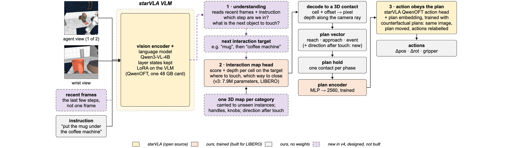
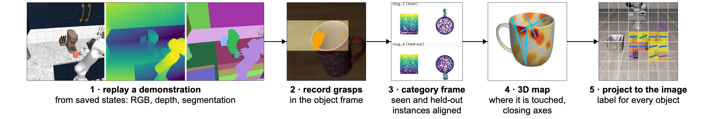
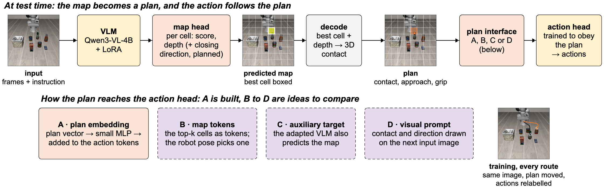

# Affordance-Guided Vision-Language-Action Models for Household Manipulation

*Research proposal · 26 November 2026 · `affordance-vla`*

## 1. Summary

Vision-language-action models (VLAs) map camera images and an instruction to robot actions, but they break when an object moves, when the instruction names another object, or when the object is a new instance of a known category. We propose a VLA whose actions are trained to follow an explicit **affordance plan**: where to touch an object and in which direction. An understanding part decides which object comes next, an **interaction map** gives the contact and direction on that object, and the action head is trained to obey the resulting plan. The map is built once per object category and carried to unseen instances, so that learning to grasp one mug transfers to any mug. We work in simulated kitchens (RoboCasa365) and keep LIBERO to connect to our earlier results.

## 2. Research questions

Affordance methods usually stop at a map handed to an external planner. A VLA can take the map as an extra input, yet nothing forces its action to depend on it. Our thesis: **affordance helps only when the action is trained to obey it**.

- **RQ1 (obedience).** If the plan is moved while the image stays the same, does the action follow, and does training for this raise success under perturbation?
- **RQ2 (category-level affordance).** Can one interaction map per category, built from demonstrations, be carried to unseen instances accurately enough to guide a grasp?
- **RQ3 (understanding).** In a multi-step task, can the model tell from recent frames which object to interact with next, and does this help on unseen task compositions?

## 3. Proposed pipeline

*Fig. 1. Gold: open-source starVLA model. Orange: our parts, built and trained on LIBERO. Grey: our steps without weights. Purple dashed: designed, not built.*

1. **Understanding: which object next.** The VLM reads the last few frames and the instruction and answers in text which step is running and what the next interaction target is ("mug", then "coffee machine"). Labels come from the per-frame sub-task annotation of composite demonstrations.
2. **Interaction map: where and which way.** A small head on the VLM predicts the map of the target object; its best cell becomes a short plan (section 4).
3. **Action obeys the plan.** The action head is trained so that it cannot ignore the plan (section 4.2).

The model sees RGB images and the instruction only; simulator ground truth is used for labels and evaluation, never as an input. The backbone is starVLA (Qwen3-VL-4B), adapted with LoRA together with a small action head, which fits one 48 GB GPU.

## 4. The affordance map

### 4.1 What it is and how it is extracted

*Fig. 2. All pictures are real: (1) a replayed RoboCasa365 demonstration; (2) demonstrated grasps, orange, on a LIBERO mug; (3) two RoboCasa365 mugs as surface points; (4) touch frequency and closing axes, cyan, on a scanned mug, here from human-hand data; (5) the planned per-object label on a LIBERO frame: colour is the score, dashes the closing direction.*

The interaction map belongs to an object **category**: over the surface of, say, a mug it stores how often each point is grasped and along which axis the gripper closes. It is built from demonstrations, without manual labels (Fig. 2); for drawer handles, door handles and knobs it also stores the motion that follows the contact. On an unseen instance the map is carried over by nearest-point matching in the category frame or by a learned descriptor field (NDF). Open issue: demonstrations cover only the side of a symmetric part that faced the robot; we will either complete the part into a ring and choose by robot position, or record grasps in a robot-facing frame.

### 4.2 How it is used and how it enters the VLA

*Fig. 3. Top: frames of a real LIBERO-PRO rollout of our model. Bottom right: a real demonstration whose path is rewritten to another object. Gold: starVLA. Orange: built and trained on LIBERO. Grey: no weights. Purple dashed: idea, not built.*

**At test time** (Fig. 3, top) a small head on the VLM's layer states predicts, for every image cell, a score and a depth; the closing direction of the gripper is planned as a third output. A semantic gate keeps the cells of the target object. The best cell and its depth give a 3D contact; with an approach point and the gripper event it forms a short plan vector, held until the gripper acts.

**Entering the action head** (Fig. 3, bottom). Route **A** is built: a small MLP turns the plan vector into an embedding that is added to the action tokens. It starts at zero, so the pretrained policy is unchanged until training moves it. Three preliminary ideas to compare on RoboCasa365, none built yet:

- **B, map tokens.** Pass the k best cells (position, depth, direction, score) as tokens instead of one decoded contact. Several contacts stay open, for example both sides of a mug rim, and the robot's pose selects one; this targets the one-sided grasps of section 4.1.
- **C, auxiliary target.** The adapted VLM also predicts the map, so its features encode where interaction happens. Used alone, it is the "affordance as auxiliary loss" baseline.
- **D, visual prompt.** Draw the contact and direction on the next input image: no new interface, a cheap baseline.

Whatever the route, the action is trained with **counterfactual plans**: for the same image the plan is moved to another object or point, and the action labels are rewritten along the new path. The model cannot fit this data while ignoring the plan.

### 4.3 Other sources of the map

| Route (literature, not re-run by us) | Gives | Limit for us |
| --- | --- | --- |
| Descriptor fields: NDF | 6-DoF gripper pose; 0.88 success on unseen upright mugs | external planner; we use it as a transfer step |
| Retrieval + correspondence: Robo-ABC, RAM | 2D contact point; 3D contact + post-contact direction | no gripper closing axis |
| Human video: VRB | 2D contact heat-map + wrist path | 2D only |
| End-to-end: AffordanceVLA | 2D contact heat-map inside a VLA | nearest neighbour; no approach direction, no weights |

Only AffordanceVLA trains a VLA with affordance; our contribution is the training for obedience. **Human hand-object data** of the HOT3D kind can fill the same map (Fig. 2, step 4). Missing for direct use: a held-grasp label, a hand-to-gripper mapping, and shapes (HOT3D: 2 mugs, 1 bowl, nothing articulated). A collection team should record object pose and mesh, the hand mesh in the same frame, hold start and end, 8–10 shapes per category, and handles and knobs.

## 5. Candidate datasets

| Dataset | Scene and scale | Why | Role |
| --- | --- | --- | --- |
| **RoboCasa365** | 2,500+ simulated kitchens, 365 tasks, 2,200+ h | many interaction types and multi-step tasks; replay from saved states; 27 mugs, 22 cups, 22 bowls with held-out instances; sub-task labels; a VLA leaderboard (best 62.6) | **main** |
| LIBERO / LIBERO-PRO | tabletop, 130 tasks; perturbed suites | our current results; only 3 mug meshes | link to earlier results |
| HD-EPIC | 9 real kitchens, 41 h, digital twins | 26.6K questions; no robot actions | later, for understanding |
| HOT3D-type data | 19 people, 33 rigid objects | hand and object meshes and poses | affordance source |

Not used: BEHAVIOR-1K (encrypted meshes; the challenge winner trained on 8×H200 for about a month) and DROID (no depth, no matching simulator). No dataset has both understanding labels and fine actions; in RoboCasa365 they can be generated from the simulator state.

## 6. Evaluation

(1) **Unseen instances** of mug, cup and bowl in seen kitchens, so that only the instance is new. (2) **Unseen task compositions**: the 16 held-out composite tasks. (3) **Understanding accuracy** on held-out kitchens and objects. (4) **Obedience**: same image, plan moved. (5) **LIBERO-PRO**. The main comparison is the same backbone with and without our method, and routes A to D against each other, with at least three training seeds; final numbers follow the official 50-task protocol.

## 7. Preliminary evidence

- **Obedience helps under perturbation (LIBERO-PRO, Object suite).** With a frozen VLM and about 31 M trained parameters, route A reaches 0.66 / 0.68 success under position / task perturbation with a predicted plan and 0.92 / 0.75 with the ground-truth plan; the released starVLA checkpoint reaches 0.00 / 0.09 (one training seed, small scale, not like-for-like with published numbers).
- **Step 0 (this week).** Carrying the mug map to a held-out LIBERO mug passed in 1 of 6 cases, because each mug always stands in one orientation. The test moves to RoboCasa365, where demonstrations replay from saved states (34–36 dB PSNR) and training and evaluation run end to end.

## 8. Plan, compute and risks

| Step | When | What | Pass criterion |
| --- | --- | --- | --- |
| 1 | now – Jan 2027 | 8 atomic tasks: labels, base policy, routes A–D | beats the same backbone on unseen instances, beyond seed variation |
| Checkpoint | end of Jan | NeurIPS 2027, or a narrower IROS 2027 paper | |
| 2 | Feb – Mar | composite tasks and step understanding | a measurable gain on unseen compositions |
| 3 | Apr onwards | official protocol, baselines, paper | |

**Compute.** Development runs on one 48 GB GPU with LoRA; full fine-tuning of the 4.5 B-parameter model needs about 70 GB (our estimate), so main results need several GPUs. **Risks.** (1) Composite-task scores are low for every published method; step 2 can fall back to the step-1 scope. (2) A LoRA-trained base policy may be too weak to compare against; step 1 measures this first. (3) "Plan, then act" is not new and AffordanceVLA is close; our difference is an action trained to obey the plan.

## References

RoboCasa365 [2603.04356] · LIBERO; LIBERO-PRO · starVLA · BEHAVIOR-1K challenge report [2512.06951] · HD-EPIC [2502.04144] · HOT3D (Meta, CVPR 2025) · NDF [2112.05124] · Robo-ABC [2401.07487] · RAM [2407.04689] · VRB [2304.08488] · AffordanceVLA [2606.06155] (arXiv numbers as checked in our survey records)
