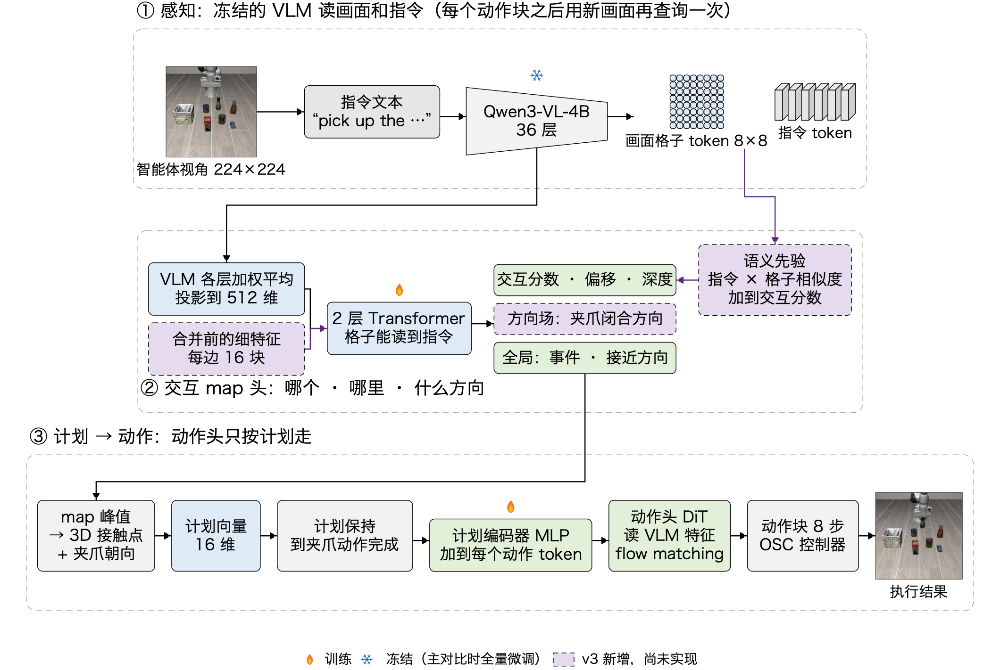
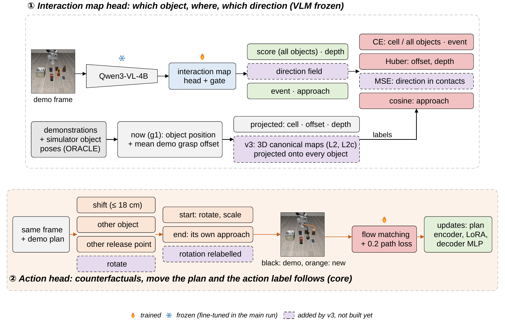
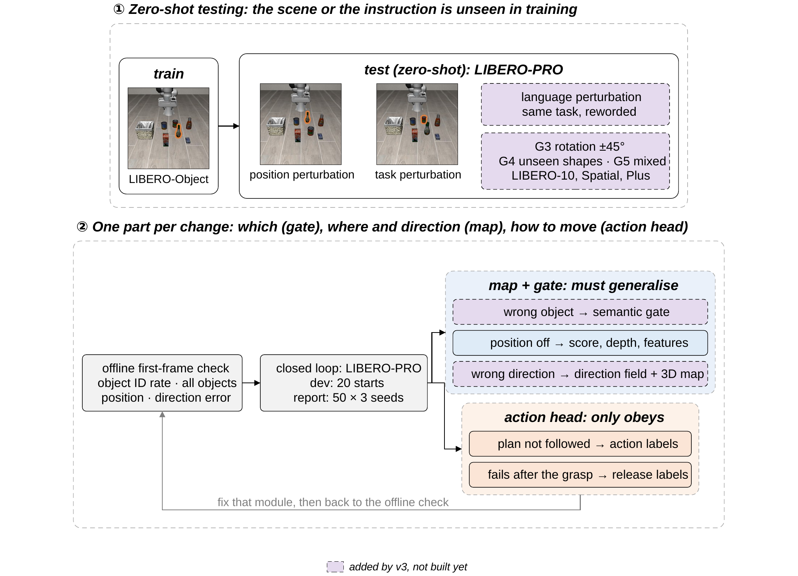

# VLA Pipeline v3：带方向的交互 affordance map + 服从它的动作头

**状态：已确认。**

- 2026-11-19：项目负责人同意第 10 节的 6 条。
- 同日晚：项目负责人确认修订，改为以交互 affordance map 为核心（第 10 节的 5 条）。
- 2026-11-20：项目负责人确认第三轮修订：每类物体的 3D 标准 map 作标签、交互 map 画所有物体并由语义门控挑目标、用 3D 对齐读物体朝向、加泛化测试（第 10 节的 4 条）。
- 2026-11-20 晚：项目负责人同意实验按三个阶段推进（第 5 节）：骨架定型 → 挑下游任务 → 对比驱动的改进。
- 2026-11-20 晚（第五轮）：项目负责人定下**泛化是最终目标之一**：学会一类物体的抓法后，高矮胖瘦不同的同类物体也要抓对。为此 L2 改成类别级，并加上高矮胖瘦测试集和 G4 的测法（第 10 节的 3 条）。

**这份文件的作用：**

- 它是本方向方法和实验的依据。之后的实验按第 5 节的三个阶段和通过标准做；要改方向，先改这份文件。
- 它取代 [Pipeline v2](2026-11-10_VLA_branch_Pipeline_v2.md) 的方法部分。v2 的 benchmark、协议和算力部分，以及 [README](README.md) 里 11-12 到 11-16 的决定，继续有效。
- 它和 `docs/pipeline.md` 里记忆方向的"Pipeline v3"无关。

**三张图：**

- 测试时的模型（第 2 节）；
- 训练（第 3 节）；
- 泛化和诊断（第 4 节）。

图里紫色虚线框是 v3 新增、还没实现的部分。图的规格和截图来源见[图的说明](../../report/media/pipeline_overview/README.md)。

## 1. 定位和泛化思路

**论点不变：** affordance 只有在动作被训练成服从它时才有用（2026-11-12 的决定）。

**v3 的核心是带方向的交互 affordance map。** 这张 map 说明：

- 夹爪在哪里接触这个物体（交互分数）；
- 以什么方向夹（方向场）。

物体不是对称的球时，比如杯子有把手，这张 map 本身就带着方向。计划（接触点和夹爪位姿）都从 map 解码出来，不另外回归。动作头只服从计划。

**哪些是统计的，哪些是学的（11-20 第五轮写明）：**

- **标签是统计出来的，不是学的。** L 从 LIBERO 自带的人工遥操作示范里，把每次抓住时夹爪的位姿换到物体坐标系，叠加成这类物体的 3D 标准 map。它只复述示范者的抓法，不判断抓法好坏：示范捏杯沿，map 就落在杯沿。
- **学的是 map 头：** 从画面和指令预测每个物体的 map。动作头学的是服从计划。
- **最终目标之一是泛化：** 学会一类物体的抓法后，高矮胖瘦不同的同类物体也要抓对（第 4 节 G4）。这要求两件事：标签在同一类的不同形状之间说的是同一种抓法（类别级的 L2，第 3 节）；map 头学到的是"杯沿、把手长什么样"，而不是记住某一只杯子。

**泛化的分工：** 一次抓取拆成三件独立的事，每件事负责一种变化（11-20）。

| 哪件事 | 由谁负责 | 应对哪种变化 |
|---|---|---|
| 抓哪个物体 | M1 语义门控 | 换指令、换目标 |
| 抓物体的哪里、朝什么方向 | M2 交互 map（画面里所有物体）+ 每类物体的 3D 标准 map（类别级） | 换位置、物体转动、同类的新物体（高矮胖瘦不同） |
| 手怎么动 | M4 动作头，用反事实样本训练 | 不负责泛化，只服从计划：计划在哪就去哪，朝向是什么就转成什么 |

- 训练只用标准 LIBERO，测试零样本，用 LIBERO-PRO 和 LIBERO-Plus。
- 三件事可以组合：几种变化同时出现时，每次失败都应能归到其中一件（第 4 节的 G5）。
- 语义信息和方向信息都放在 map 这一侧，动作头不加这类模块。语义只在对照 F 里加到动作头（第 6 节）。

**每类失败对应一个模块：**

| 失败 | 归到 | 对应模块 |
|---|---|---|
| 指向了别的物体 | 语义 | M1 语义门控 |
| 物体对，接触位置偏 | 几何 | M2 交互 map 的分数和深度 |
| 位置对，夹爪方向不对（抓滑、碰倒） | 方向 | M2 的方向场 + L 的交互标签 |
| 计划对，动作没跟上 | 服从 | M4 动作头 + M5 反事实标签 |
| 抓到之后，搬运或放置失败 | 后段 | 释放阶段的计划和标签（已有，继续） |

## 2. 管线

| 模块 | 内容 | 状态 | 代码 |
|---|---|---|---|
| M0 VLM | starVLA QwenPI 的官方权重，底座是 Qwen3-VL-4B。诊断和消融时冻结，主对比时全量微调 | 不变 | 不变 |
| M1 语义门控 | 指令 token 和格子 token 的余弦相似度（借鉴 SemanticVLA 的 ID-Pruner），得到一张语义图。目标分数 = 语义权重 × 交互分数，语义权重 = softmax(α × 相似度)，α 从 0 开始学，开始时等于没有语义。合并方式（求和还是取最大值）在 E1 里不训练、直接比较后选定；冻结 VLM 的相似度不够准时，再加一个小的可学习投影 | 新增（11-20 从加法改为乘法） | `affordance_vla/heads/semantic_prior.py` |
| M2 交互 map 头 | 输入：VLM 各层的特征，以及更细的视觉特征。更细的特征先用 VLM 视觉编码器在合并之前的那一层（每边 16 块，不加新模型），不够再加 DINOv2。每个点输出交互分数、方向场（夹爪闭合方向，用 cos2θ 和 sin2θ 表示，所以转 180° 自动算同一种抓法）、深度。**交互分数对画面里所有物体都画**，不只是被点名的那个，挑目标交给 M1。全局输出事件和接近方向，和现在一样 | 修改：现有的 8×8 格子头是它的第一版 | `affordance_vla/heads/plan_grid.py` 扩展，或新文件 `interaction_map.py` |
| 解码 | 接触点：门控后目标分数的峰值，加上深度和相机标定，得到 3D 位置。夹爪朝向：接近方向，加上峰值处的闭合方向。物体朝向：第二阶段用 3D 对齐读出，见表下 | 修改 | 同上 |
| M3 计划向量 | 加上目标朝向（相对当前夹爪，6D 表示），从 10 维变成 16 维。计划保持不变 | 修改 | `affordance_vla/plan/plan_input.py`、`heads/plan_policy.py` |
| M4 动作头 | 结构不变。旋转（动作第 3–5 维）单独报误差 | 不变 | `heads/plan_policy.py` |
| M5 反事实标签 | 在 15 日的标签（s10）上加"转朝向"：先设绕竖直轴 ±45°，E0 之后再定。动作的平移和旋转一起改写 | 修改 | `training/plan_samples.py`、`training/counterfactual.py` |
| L 交互 map 标签 | 每类物体一张 3D 标准 map，投到每一帧的所有物体上，见第 3 节。第五轮起是类别级：同一类的不同网格共用一张，记在归一化的类别坐标系里 | 新增：每个网格一张已实现（`ec1c792`）；类别级未实现 | `affordance_vla/plan/interaction_labels.py` |
| 执行 | OSC 控制器负责算关节，不训练正逆运动学 | 不变 | — |

新功能都做成命令行开关，默认关闭，这样以前的运行照样能复现（AGENTS.md）。

**3D 用在哪里（11-20）：** 标签（每类物体的 3D 标准 map）、读物体朝向（3D 对齐）和评测。模型的输入和输出仍是图像上的 map 加深度；每个格子用深度和相机标定就能还原成 3D 点（`plan_grid.py` 的 `pixel_contact`）。

**3D 对齐读物体朝向（第二阶段）：** 把这类物体的 3D 标准 map 放到预测的物体位置，绕竖直轴每 10° 转一档，投到画面上，和预测的 map 比较（交互分数的重合度，加上方向场的一致程度），取最吻合的角度。这和 AROS 的做法一样：转着试，看哪个角度对得上。在物体坐标系里只剩朝向一个未知量，不像在 2D 图上那样和视角混在一起。小物体在 8×8 格子里只占 1–2 格，点太稀时先用更细的特征和接近时的腕部视角。

## 3. 训练

### 交互 map 的标签（最关键的一步）

| 来源 | 内容 | 成本 |
|---|---|---|
| L1 示范 | 每次抓取那一刻，用夹爪位姿（日志里已有 `ee_pos`、`ee_quat`）和物体分割图，得到"接触区域 + 闭合方向"的逐像素标签 | 只用 CPU，日志现成 |
| L2 每类物体的 3D 标准 map | 把同一类物体的所有抓取换到物体自己的坐标系里，落到物体表面上，叠加成这类物体的 3D 标准 map：表面点、交互分数、闭合轴。闭合轴转 180° 不变，存成 d·dᵀ 的平均，取主方向；主方向不明显，说明这类物体的朝向无所谓（如罐子）。再按物体位姿投到任何一帧的**每个物体**上，得到 2D 标签和深度。这样每一帧都有完整标签，对称物体会得到多个可行的抓法；"换物体"的反事实样本和 LIBERO-PRO 首帧也都有真值 | 物体位姿已补记（Object 500/500，LIBERO-10 回放中）。物体表面从 MuJoCo 模型的网格或碰撞几何取；有些物体由基本几何体拼成，要先核对 |
| L1 的精确版（可选） | 借 AROS 的交互面：用夹爪网格和物体网格，算出抓取那一刻两者之间的面，得到更准的接触区域 | 只用 CPU；L1 不够准时再做 |
| L3 脚本抓取 | 换不同朝向去抓，记下成功和失败 | 暂不做 |

**仿真里的物体位姿只用来生成标签和做评测，测试时不输入模型。**

### 类别级的 L2（11-20 第五轮）

**为什么要改：** LIBERO 里"一类"物体通常只有一个网格，所以现在的 L2 实际上是"每个物体一张 map"，还不能说明换了形状怎么抓。杯子是唯一有几种网格的类别（11-20 核对过 LIBERO 的资源和任务文件）：

| 杯子 | 网格 | 示范里被抓的任务 |
|---|---|---|
| 白杯子 | `porcelain_mug` | LIBERO-10 的 2 个任务；LIBERO-90 的 3 个任务 |
| 黄白杯子 | `white_yellow_mug` | LIBERO-10 的 2 个任务；LIBERO-90 的 3 个任务 |
| 红杯子 | `red_coffee_mug` | 只有 LIBERO-90 的 4 个任务（LIVING_ROOM_SCENE5 两个、SCENE6 一个、STUDY_SCENE3 一个） |

LIBERO-90 的示范还没下载；和 LIBERO-10 一样，只取状态和动作。

**做法：**

1. **类别坐标系：** 同一类的每个网格都换到一个共同的坐标系里：竖直轴朝上（有些网格是躺着建的，例如罐头沿自己的 y 轴）；原点放在底面中心；高度和水平半径分别归一化到 1；有把手的绕竖直轴转到把手朝 +x（把手方向取离竖直轴最远的那些表面点的水平方向）。
2. **类别级 map：** 这一类所有网格的抓取都换到类别坐标系里叠加，得到一张 map：表面点、交互分数和闭合轴，和现在的 L2 一样。
3. **搬到任何一个网格上：** 这个网格先换到类别坐标系，每个表面点取最近的类别 map 点的分数和闭合轴；太远的点记 0。闭合轴按法向的规则换算：乘以缩放的逆，再归一化。然后和现在一样投到每一帧上。新网格不需要新示范。

**检查（留一种杯子）：** 用两种杯子的示范做类别级 map，搬到第三种上，和第三种自己的示范统计出的 map 比较。三种杯子轮流留出。

- 留出的杯子自己的示范抓取，八成以上落在搬过来的 map 的高分区域（分数前 20% 的表面）；
- 闭合轴误差的中位数小于 20°（和 L 的分组阈值一样）。

阈值先这样定。看到第一批结果后可以调，调了要在"进展"里记。

**高矮胖瘦测试集（G4 的缩放部分）：**

- 在 MuJoCo 里把杯子网格沿高度或水平方向缩放，可视几何和碰撞几何一起缩放。先定这几档：高 ×0.8、×1.3；粗 ×0.8、×1.2；再加两种组合（高而瘦、矮而胖）。
- 标签跟着同样缩放：表面点乘缩放，闭合轴按上面的法向规则换算。真值不用另外标。
- 场景用 LIBERO-10 杯子任务的起始状态，只换杯子的形状。
- 看图检查每一档：杯子放得稳，夹爪伸得进杯口，标签投回画面落在杯沿或把手上。

### 两个头的训练

| 部分 | 数据 | 损失 | 规模 |
|---|---|---|---|
| 交互 map 头（含 M1） | `dataset10` 加上 L1、L2 的标签，之后再加 `dataset_spatial` | 交互分数：对所有物体的标签（每格是否在某个物体的接触区域，二元交叉熵）。目标分数（门控之后）：对点名物体的标签分布（多个可行抓法）的交叉熵，只更新 M1，这样"抓哪个"和"抓哪里"不缠在一起。方向场：只在接触区域内算 cos2θ、sin2θ 的 L2。深度：Huber。事件和接近方向：和现在一样 | 冻结 VLM，单卡几千步 |
| 动作头 | 同上，加反事实样本 | flow matching 动作损失。平移和旋转的标签都按反事实改写 | 消融：LoRA，约 3100 万参数。主对比：全量微调（需要整机时段） |

先在冻结的 VLM 上把各模块验证完，再做全量微调。

**动作头要训练，但 11-20 的改动不影响它：** 计划向量的格式不变；"换物体"的反事实样本已经训练它去任何被指定的物体，所以门控挑谁它就去谁。朝向进计划（16 维）后要重训一次，这是 E3 原本就有的。

## 4. 测试和诊断

**离线检查**（便宜，每次改了 map 头都先做）：在 LIBERO-PRO 每个起始状态的第一帧上看 map 的输出。

- **认对物体率：** 门控后的峰值落在指令点名的物体分割区域里的比例。
- **所有物体的 map：** 每个物体自己区域里的峰值，是否落在它的接触区域里（不只看被点名的）。
- **位置误差：** 认对时沿视线方向和垂直视线方向分开算（现有的 plan audit）。
- **闭合方向误差：** 单位是度，按 180° 对称取较小的。真值来自 L2。
- **物体朝向误差：** 第二阶段再算：3D 对齐读出的朝向和仿真真值之差，单位度，按物体的对称性取最小。

**闭环：** 用 `scripts/eval/run_libero_pro_gpu.sh`。

- 开发阶段：LIBERO-PRO Object 的位置扰动（`_swap`）和任务扰动（`_task`），每个任务 20 个起始状态，种子 7。
- 加测语言扰动 `libero_object_lan`。
- 朝向的主要测试加一个有把手物体的任务集：LIBERO-10（杯子、摩卡壶）和它的 LIBERO-PRO 版本（`libero_10_*`）。LIBERO-Object 的物体接近对称，朝向信息不多。
- 正式报告的数字按论文协议：50 个起始状态，种子 7、8、9。
- 每个失败的 episode 归到第 1 节表里的一类，结果按任务报。

### 泛化测试（E7，11-20 加）

| 测试 | 改变了什么 | 主要考哪部分 | 数据 |
|---|---|---|---|
| G1 | 物体位置 | 交互 map 跟着物体走 | LIBERO-PRO `_swap`（已有） |
| G2 | 指令或目标 | 语义门控挑物体 | LIBERO-PRO `_task`、`_lan`（已有） |
| G3 | 物体绕竖直轴转 ±45° | 3D 对齐读朝向 | LIBERO-10 带把手的杯子、摩卡壶；扰动自己加 |
| G4 | 同类但没见过的形状（高矮胖瘦） | 类别级的 3D 标准 map + map 头 | 缩放集：LIBERO-10 杯子任务里缩放杯子网格（第 3 节）。红杯子：训练不用，LIBERO-90 抓红杯子的 4 个任务只用来测试 |
| G5 | 以上几种同时出现 | 三部分一起 | 自己组合 |

- 每个测试看两层：各部分单独准不准（认对物体率、接触点误差 cm、朝向误差 °），和闭环成功率。
- **G4 是最终目标之一（第五轮）。**
  - 训练只用一部分形状（白杯子、黄白杯子的原始网格），在没见过的形状上测。
  - 两层都和见过的形状比，看差多少。
  - 三组对照：
    - 每个网格一张 map 的标签，对类别级标签；
    - 真值计划：分开是 map 的问题还是动作头的问题；
    - 官方权重。
  - 红杯子任务的指令也是训练里没见过的，所以同时考 G2；失败归类时，认错物体和抓的位置、方向错分开算。
- 对照：官方权重、去掉语义门控、只用 2D（不做 3D 对齐）、真值计划（上限）。
- **泛化雏形成立的判据：** G5 的每次失败都能归到某一部分；把那一部分换成真值后，成功率回升。

## 5. 实验推进：三个阶段（11-20 确认）

**思路（项目负责人）：**

1. 先让 pipeline 按期望的方向定型，确认骨架不再变；
2. 再挑合适的下游任务；
3. 按下游任务上的对比结果，有针对性地回到某个模块改进，或者加新的创新点。

**骨架和可替换的部分：** 骨架定型后不再改；之后的改进只替换某个可替换的部分，或者在骨架上加一个模块。失败归类（第 1 节的表）把每次失败指到一个模块，这就是"回到哪里改"的依据。

| 骨架（定型后不变） | 可替换的部分（阶段 3 按结果改） |
|---|---|
| VLM 读画面和指令 | 冻结，还是全量微调 |
| 交互 map 头：所有物体的分数、深度、方向；全局的事件和接近方向 | 特征：8×8 → 合并前 16×16 → DINOv2 → 加腕部视角 |
| 语义门控挑目标 | 余弦相似度 → 加可学习投影 |
| 解码成计划向量，计划保持 | 物体朝向：不读 → 3D 对齐 |
| 动作头用反事实样本训练成服从计划 | 反事实的种类和标签规则 |
| 标签来自仿真里的交互（L1、L2，L2 是类别级的） | L1 → 交互面；类别级 map 的搬运方式：最近点 → 按部位 → 语义对应；训练数据：Object → 加 LIBERO-10、Spatial |
| 评测：离线首帧检查 + 闭环 + 失败归类 | 下游任务集（阶段 2 定） |

**三个阶段：**

| 阶段 | 时间 | 做什么 | 结束时由项目负责人决定 |
|---|---|---|---|
| 1 骨架定型 | 到约 12-10 | 下表 E0–E3、E4 的最小版本和 L2c，回答四个问题：语义门控能不能挑对物体；画所有物体会不会让位置变差；朝向要不要进计划；类别级 map 能不能搬到没见过的杯子上。产出：骨架版 v3 在 LIBERO-PRO Object 和 LIBERO-10 上的闭环结果（开发协议），以及建好的高矮胖瘦测试集 | **决定点 1：** 骨架定型，之后本文件的骨架部分不再改 |
| 2 挑下游任务 | 约 12-11 至 12-17 | 下表 S：候选任务集上只做推理，挑出主任务集和次要任务集 | **决定点 2：** 任务集和固定的测试协议 |
| 3 对比驱动的改进 | 约 12-18 至 2027 年 1 月底 | 一轮一轮改进（见表下）；基线 E6；1 月中全量微调；1 月底按论文协议出数字（E7） | 每轮加哪个创新点 |

**比较的基准**是同协议下现有最好的组合：动作头 `s10_scale_own10` + 格子计划头 `g1` + 计划保持。20 个起始状态、种子 7 时：

| 计划来源 | 位置扰动 | 任务扰动 |
|---|---|---|
| 格子计划头 `g1` | 129/200 | 151/200 |
| 真值计划 | 186/200 | 166/200 |

在 200 次试验、成功率 75% 左右时，一个标准差约为 6 次。

| 步 | 阶段 | 内容 | 算力 | 通过标准 | 不通过时 |
|---|---|---|---|---|---|
| E0 | 1 | **位姿假设检验。** 用已有的日志比较抓取时刻的夹爪朝向：成功对失败，以及和同一物体的示范相比。第一版用世界坐标 | 只用 CPU | 失败抓取的朝向偏离示范，明显大于成功抓取（例如中位数差 10° 以上），而且和视频对得上。结果也用来定"转朝向"的角度范围 | 方向分支（E3、E5）暂停，在 Object 上另找失败原因；方向在有把手物体的任务集上再测 |
| E1 | 1 | **语义诊断。** ① 把 g1 在首帧上的错误分成"认错物体"和"认对但位置偏"；② 不训练，看冻结 VLM 里指令 token 和格子的相似度图，比较求和与取最大值哪个更准地落在点名的物体上 | 推理，单卡 | 只是诊断：选定合并方式，决定 E2 的重点 | — |
| L | 1 | **建交互 map 的标签（L1 + L2）。** 重新回放示范、补记物体位姿，生成每类物体的 3D 标准 map，投到每一帧的所有物体上，检查同类物体之间的方向是否一致 | 只用 CPU，和 E0、E1 同时做 | 同一类物体多次抓取的闭合方向，在物体坐标系里聚成少数几簇；3D map 投影回画面后和示范帧对得上（看图检查） | 先查回放和投影 |
| L2c | 1 | **类别级 map 和高矮胖瘦测试集**（第五轮，做法见第 3 节）。下载 LIBERO-90 里抓杯子的 10 个任务的示范（只取状态和动作），重新回放、补记物体位姿；建杯子的类别级 map，三种杯子轮流留出做检查；按几档缩放建测试集 | 只用 CPU，和 E2 同时做 | 留出的杯子：自己的示范抓取八成以上落在搬来的 map 的高分区域，闭合轴误差中位数小于 20°。缩放集：每一档看图检查（放得稳、夹得进、标签落在杯沿或把手上） | 先查对齐；再改成按部位记（杯沿、把手、杯身）；仍不行，G4 只用缩放集，它的标签由缩放直接得到，不依赖搬运 |
| E2 | 1 | **语义门控。** 在现有的 8×8 头上加 M1 的乘法门控（`g2_semantic`），交互分数改用 L2 的所有物体标签，配 s10 动作头 | 训练计划头 + 闭环 | 离线认对物体率提高，tomato sauce 不能再是 0% 选对格子。闭环位置扰动超过 129，任务扰动不低于 145 | 回到 g1 的做法：交互头直接学点名的物体，不用 M1 |
| E3 | 1 | **朝向的上界。** 真值朝向进计划（16 维）对比 10 维真值计划，动作头加 ±45° 的"转朝向"反事实；再给真值朝向加噪声，看误差到多大成功率开始下降 | 训练动作头 + 闭环 | 用真值计划时成功率提高，抓取失败和碰倒减少 | 朝向不进计划，只留作分析 |
| E4 | 1（最小版本）、3 | **交互 map 头。** 最小版本（阶段 1）：8×8 头加方向场，用 L 的标签训练（所有物体），E3 说朝向有用时做，进骨架。更细的分辨率放到阶段 3，位置偏是主要失败时再做 | 训练 map 头 + 离线检查 | 认对物体率不低于 E2；位置误差中位数下降；闭合方向误差小于 E3 测出的容忍范围 | 先查标签和分辨率 |
| S | 2 | **挑下游任务。** 候选：LIBERO-PRO Object、LIBERO-10、Spatial，LIBERO-Plus，G3 自己加的扰动，G4 的缩放集和红杯子任务（L2c 建好），带抽屉和旋钮的任务。每个候选只做推理，跑三组：官方权重、骨架版、骨架版加真值计划；20 个起始状态、种子 7；失败按五类归 | 推理，多卡并行 | 按五个标准挑：真值计划比官方权重高很多；我们和真值计划的差距能归到骨架里的模块；失败类型和论点对得上；有已发表的数字可以并列；成本可以接受 | — |
| E5 | 3 | **用 map 解码出的计划做闭环**，包括位置和朝向；在阶段 3 里，是每一轮改进后的闭环 | 闭环 | 高于 E2 的结果；在有把手物体的任务集上高于不带朝向的版本 | 真值朝向的上界写进论文的分析部分 |
| E6 | 3 | **同骨干基线**（第 6 节） | 轻量训练 | — | — |
| E7 | 3 | **推广：** LIBERO-Spatial（数据已备好）、LIBERO-10、按论文协议重跑、全量微调的主对比；然后做第二阶段：用 3D 对齐读物体朝向；泛化测试 G1–G5（第 4 节） | 整机时段要提前通知 | 和论文里的数字并列 | — |

**阶段 3 的每一轮：**

1. 在选定的任务上跑骨架版和基线（B、D、E、F，官方权重作参考行）；
2. 把失败按五类归，找出"我们输得最多"的那一类；
3. 回到对应模块的可替换部分，或者加一个创新点（下表）；
4. 先离线检查，再闭环（开发协议）。超过噪声才保留：200 次试验时一个标准差约 6 次，取 2 倍；
5. 在本文件的"进展"里记一行：改了什么、针对哪类失败、结果如何。

| 输得最多的一类 | 先回到哪里 | 可以加的创新点 |
|---|---|---|
| 认错物体 | 语义门控 | 可学习投影；空间语言（"左边那个碗"） |
| 位置偏 | map 的特征和标签 | 更细的特征；腕部视角的 map；在闭环帧上训练 map；交互面标签 |
| 方向错 | 方向场、3D 标准 map | 3D 对齐读物体朝向；"转朝向"的反事实 |
| 没跟上计划 | 动作头的标签 | 更多反事实种类；计划噪声 |
| 抓到后失败、两步任务做不完 | 释放阶段、计划的先后 | 子目标选择：两步任务里先抓哪个 |

**G4 上的失败**（同类没见过的形状）也按这五类归。位置偏或方向错是主要失败时，可以加的创新点：

- 用缩放或换了网格的物体渲染训练帧，训练 map 头。map 头不需要动作，所以不需要新的示范；测试用的缩放档位不进训练。
- 标签改成按部位记。
- 用语义对应搬运 map（Robo-ABC 的做法）。

- 每个条件至少 6 个起始状态，开发阶段用 20 个。
- 结果按任务报，不只报总数。
- E7 之前先查清：官方权重在 Spatial 上的三个评测作业（166–168）为什么没跑完。

## 6. 基线（同一个骨干）

11-16 列过 5 个候选：

- A：普通微调；
- B：有计划输入，但只用示范训练；
- C：affordance 只作辅助预测；
- D：有反事实数据，但没有计划接口；
- E：Fast Plans 的修法。

v3 新增一个：

- **F：隐式语义，没有 affordance。** 动作头只看和指令最相关的图像 token（SemanticVLA 的剪枝方式，搬到我们的骨干上），不给计划，用普通示范训练。

**选定 B、D、E、F 四个**，官方权重作参考行。SemanticVLA 本身用 OpenVLA-7B，也没有公开权重，所以不进主表。

## 7. 不做的事

- 不换到 OpenVLA 骨干，不复现 SemanticVLA 整套。
- 动作头里不加语义剪枝（只在对照 F 里用）。
- 不训练正逆运动学。
- 模型只做 2D 图像上的 map（加深度），不做以 3D 点云为输入的网络；3D 只用在标签、读物体朝向和评测上（11-20）。
- 第一版只从 map 读夹爪朝向；读物体朝向放在第二阶段（E7），用 3D 对齐。
- 暂不做 L3 脚本抓取，也不用外部 6-DoF 抓取数据（ACRONYM 等）。
- 同类的新形状先只用 LIBERO 自带的 3 种杯子和缩放。从外部网格库（Objaverse 等）加新杯子放到阶段 3，需要时再定。
- 测试时不把仿真里的物体位姿输入模型。
- episode 状态、记忆方向、人类视频继续不在主线（11-12 的决定）。

## 8. 停止和调整规则

- **原来的规则继续有效：** 扰动下预测的接触点到不了约 2 厘米，或者强基线不留提升空间，就换论点。
- **E0 不通过：** Object 上的方向分支暂停，方向改到有把手物体的任务集上验证。
- **E2 不通过：** 回到 g1 的做法（交互头直接学点名的物体），不用语义门控。
- **3D 对齐读不出朝向**（点太稀或对不上）：先换更细的特征、加腕部视角；仍然不行，就在 map 头上直接回归物体朝向，3D 标准 map 只用来生成它的标签。
- **E4 的方向场学不出来：** 检查 L 的标签。仍然不行，就回退到每格回归朝向的做法。
- **L2c 的类别级 map 搬不到留出的杯子上：** 先查对齐；再改成按部位记；仍不行，G4 只用缩放集，它的标签由缩放直接得到。
- **阶段 3 的每一轮：** 改进超过噪声的 2 倍（200 次试验约 12 次）才保留，否则退回上一版。
- **记录：** 每一步的结果写进 `docs/vla/` 的日期记录，并在本文件末尾的"进展"里加一行。

## 9. 时间（计划，11-20 按三个阶段改）

| 日期 | 内容 |
|---|---|
| 11-20 – 12-10 | 阶段 1：E1、L、E2、E3、E4 的最小版本；L2c（类别级 map、高矮胖瘦测试集，只用 CPU，和 E2 同时做）；决定点 1（骨架定型） |
| 12-11 – 12-17 | 阶段 2：下游任务筛选 S；决定点 2（任务集）；12 月中通知整机时段的需求 |
| 12-18 – 2027-01 底 | 阶段 3：对比驱动的改进、基线 E6；1 月中全量微调；1 月底按论文协议出数字（E7），按 11-12 的决定判断投 NeurIPS 还是 IROS |

## 10. 项目负责人确认的事

**2026-11-19，第一轮（6 条）：**

1. 用 v3 作为之后的指导，取代 Pipeline v2 的方法部分。
2. 采用第 5 节的顺序和通过标准。
3. 基线定为 B、D、E、F 四个。
4. 测试加 LIBERO-PRO 的 `_lan` 套件。
5. LIBERO-Spatial 挪到 E7。
6. 恢复实验，从 E0、E1 开始。

**2026-11-19 晚，修订（5 条，加上两条细节）：**

1. 定位改为以带方向的交互 affordance map 为核心，计划从 map 解码。
2. 标签用 L1 + L2：重新回放示范、补记物体位姿；物体位姿只用来生成标签和做评测；L3 暂不做。
3. 第一版做 2D 图像上的 map（加深度），不做 3D 点云。
4. 朝向的主要测试加一个有把手物体的任务集（LIBERO-10 和它的 LIBERO-PRO 版本）。
5. 用 map 的相似度读物体朝向放在第二阶段，第一版只读夹爪朝向。

两条细节：

- 语义图的合并方式在 E1 里不训练、直接比较求和与取最大值，选落在点名物体上更准的那种。
- "转朝向"先设绕竖直轴 ±45°，等 E0 看失败抓取的朝向偏了多少再定。

**2026-11-20，第三轮（4 条）：**

1. L2 标签直接做成每类物体的 3D 标准 map（物体坐标系里的表面点、交互分数、闭合轴），2D 标签由它投影得到。模型仍是 2D 加深度，所以修订的第 3 条不变。
2. 交互 map 对画面里所有物体都画，语义权重乘上去挑目标（M1 从加法改为乘法门控）。改动 E2、E4。
3. 第二阶段读物体朝向改成 3D 对齐，取代修订第 5 条里的"比相似度"。
4. E7 加泛化测试 G3–G5；G1、G2 就是现有的 `_swap`、`_task`、`_lan`。

**2026-11-20 晚，第四轮（2 条）：**

1. 实验按三个阶段推进（第 5 节）：骨架定型 → 挑下游任务 → 对比驱动的改进，两个决定点由项目负责人确认。这改变了原来 E0–E7 的顺序：E4 的其余部分和 E5 变成阶段 3 里按失败类型触发的改进，E7 的推广拆进阶段 2 和阶段 3。
2. GPU 队列：本项目的作业可以设优先级 164，排在另一个项目的作业前面。

**2026-11-20 晚，第五轮（3 条，加上一条队列规则）：**

起因：项目负责人问 L 的 map 是不是学出来的，以及学会一种杯子以后，换了高矮胖瘦的杯子能不能抓对。回答：标签是从示范统计的，学的是 map 头；LIBERO 里一类物体通常只有一个网格，所以现在的 map 还说明不了换形状怎么抓。项目负责人定下**泛化是最终目标之一**。

1. L2 改成类别级：同一类的不同网格对齐到共同的类别坐标系，map 记在这个坐标系里，新网格对齐后直接搬过去（第 3 节）。
2. 加高矮胖瘦测试集：缩放杯子网格，标签跟着缩放；红杯子作为真正没见过的形状。阶段 1 建好（L2c），阶段 2 作为候选任务集。
3. G4 的测法：训练只用一部分形状，在没见过的形状上测离线和闭环两层；对照为每个网格一张 map 的标签、真值计划和官方权重（第 4 节）。

队列规则：本项目的 GPU 作业提交时用 `cards=7`，优先用 GPU 7，控制用卡。

## 进展

- 2026-11-19：项目负责人确认第一轮的 6 条；画了三张图，更新了 [README](README.md)。
- 2026-11-19 晚：项目负责人确认以交互 affordance map 为核心的修订；文档和三张图已按修订更新。下一步：E0、E1、L。
- 2026-11-20 **E0 不通过**（[notebook](../../report/experiments/2026-11-20_grasp_orientation.ipynb)）。
  - 失败的首次抓取离最近的示范，只比抓住的多偏 1.4°（图像格子计划）和 1.6°（真值计划），通过线是 10°；示范本身也几乎只有一种抓法。
  - 真正的差别在位置：闭合时夹爪离物体中心的距离，中位数 2.0 cm（抓住且成功）对 4.7 cm（没抓住）。
  - 按第 8 节的规则：方向分支在 LIBERO-Object 上暂停，E3、E5 改到 LIBERO-10；"转朝向"的角度范围到那里再定。Object 上先做交互 map 的位置部分，以及 E1、E2。
- 2026-11-20：项目负责人确认第三轮的 4 条；文档和三张图已更新。
  - **E1 第一次运行失败。** 探针按 token 编号找指令，但提示词是"Your task is {instruction}. …"，指令的第一个词在上下文里带前导空格，编号对不上。改成按字符位置匹配，用真实的分词器核对过，已重新排队。
  - **LIBERO-10 示范回放第一次全部失败。** 文件名带场景前缀（`KITCHEN_SCENE3_…`），不是指令本身。修好后重新回放（每个任务 50 条，只用 CPU）。
  - **官方权重在 LIBERO-PRO 的 LIBERO-10 上**（每个任务 20 个起始状态，种子 7）：位置扰动 3/200，任务扰动 18/160。任务扰动的任务 2、3 没跑：它们第一个关注物体是灶台和柜子，不能抓；脚本改成取第一个可抓的物体，已重新排队。
- 2026-11-20 晚：项目负责人同意三阶段推进和队列优先级（第 10 节第四轮）；第 5、8、9 节已改。第二周周报（[notebook](../../report/2026-11-16_weekly_review.ipynb)）记录了 pipeline 这一周的变化。官方权重在 LIBERO-10 杯子任务的任务扰动下，照着训练时的原指令摆放，没有理会改过的指令。

- 2026-11-20 晚：**L 通过**（`ec1c792`，第二周周报 3.3 节）。
  - 每类物体一张 3D 标准 map：LIBERO-Object 10 类（每类 47–51 次抓取），LIBERO-10 10 类（36–170 次）。产物在 `runs/interaction_labels/{object,libero10}/`。
  - 抓取改成"仿真报告抓住、并持续 5 步"：E0 那条"闭合后 15 步内抓住"的规则，让 ketchup 只剩 21 次（很多示范手指早早就合上）。
  - Object 的 10 类里 9 类的闭合轴最大组占八成以上，tomato sauce 约 76%。杯子按杯沿上的不同位置分成几组，每个表面点上的方向一致度 0.93–0.97。LIBERO-10 的 alphabet soup 分成两大组（63 / 37），原因待查。
  - 看图检查了 5 类，投回画面都和示范抓住的位置对得上。摩卡壶的 map 落在把手上，杯子落在杯沿上。
  - E1 第二次运行失败：Spatial 的碗在 `dataset10` 里没有抓取偏移。已修复（`9e598cd`），重新排队。
  - 下一步：把 3D 标准 map 投到训练帧上，生成 E2 的"所有物体"标签。
- 2026-11-20 晚：项目负责人确认第五轮（第 10 节）：泛化是最终目标之一；L2 改成类别级；加高矮胖瘦测试集和 G4 的测法（第 3、4、5 节）。核对过 LIBERO 的杯子：3 种网格。红杯子只在 LIBERO-90 里被抓，那部分示范还没下载。GPU 作业从此用 `cards=7`。

## 参考

- **AROS**（Pacheco-Ortega、Mayol-Cuevas，Frontiers in Robotics and AI，2023，"AROS: Affordance Recognition with One-Shot Human Stances"）：在人和场景之间算交互平分面（IBS），用从这个面指向环境的向量和人体周围的留空向量描述一次交互；在 3D 场景表面上逐点转着试 8 个朝向打分。借鉴的部分：用交互面生成更准的接触区域（L1 的精确版），以及"转着试、看哪个角度对得上"的朝向读取（3D 对齐）。
- **SemanticVLA**（AAAI 2026 oral）：[arXiv 2511.10518](https://arxiv.org/abs/2511.10518)，[代码](https://github.com/iLearn-Lab/AAAI26-SemanticVLA)。借鉴的部分：指令和图像块的相似度（ID-Pruner）、更细的视觉特征。
- **带方向的 affordance 和类别级迁移：**
  - GG-CNN：逐像素的抓取质量、角度（cos2θ、sin2θ）和宽度；
  - Where2Act：逐像素的可操作性和动作方向；
  - Dense Object Nets、Neural Descriptor Fields：用描述子相似度把同类物体上的抓法和朝向迁移到新物体；
  - kPAM：类别级关键点给出物体朝向。

  这几篇凭记忆列出，写论文前要核实全文。
- **Robo-ABC**（Ju 等，ECCV 2024，[arXiv 2401.07487](https://arxiv.org/abs/2401.07487)）：用人类视频建一个接触点的记忆库；遇到新物体时，先检索相似的物体，再用扩散模型特征的语义对应，把接触点搬到新物体上，可以跨类别。借鉴的部分：类别级 map 搬到新形状时，可以用语义对应代替最近点（阶段 3 的可选创新点）。只读了摘要。
- **图：** `report/media/pipeline_overview/` 下的 `v3_model.png`、`v3_training.png`、`v3_generalization.png`。11-18 只加了朝向的方案图 `pose_plan_pipeline.png` 留作记录，已被这三张图取代。
