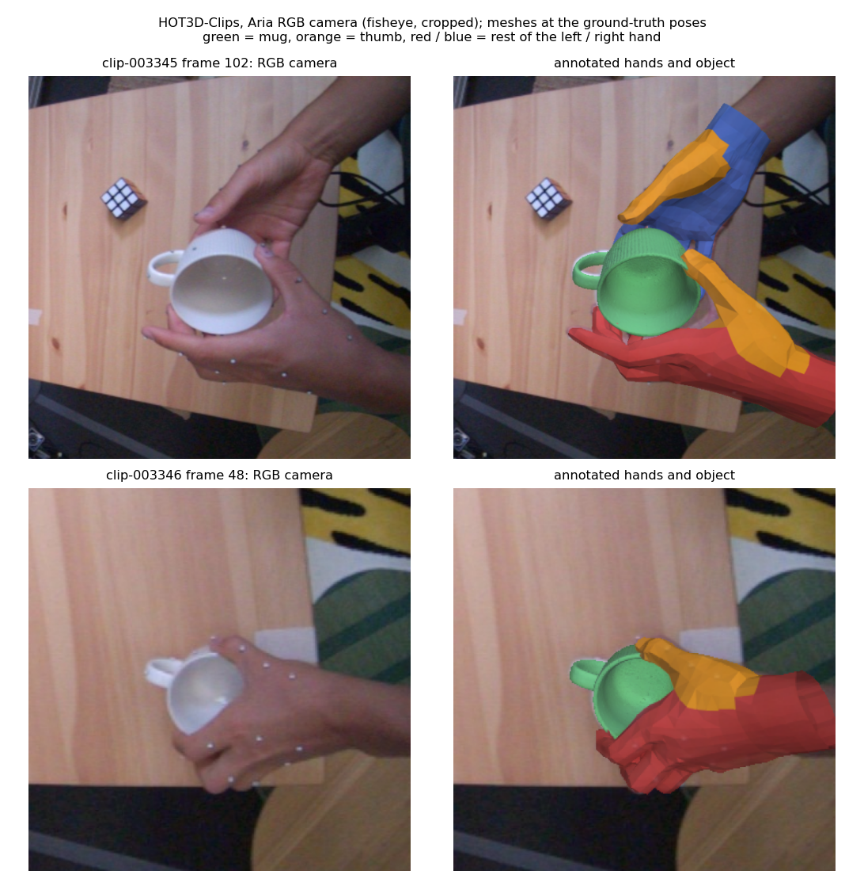
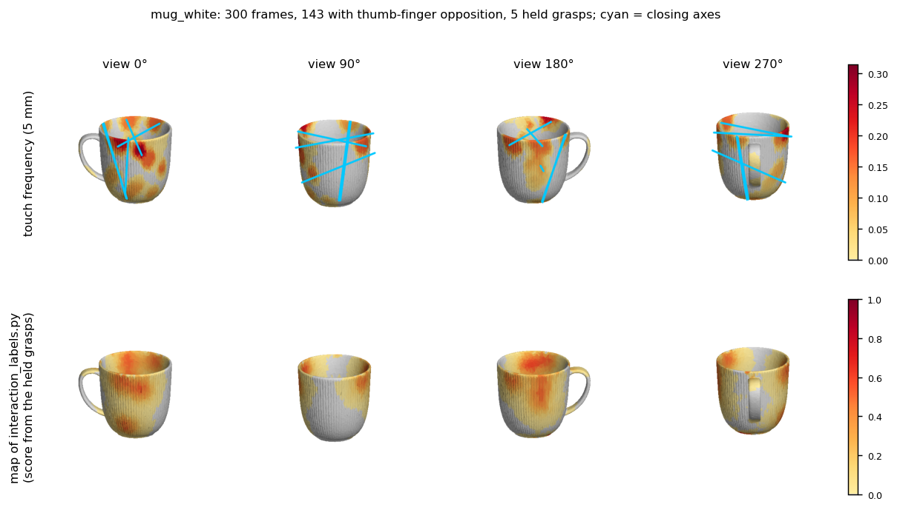

# HOT3D 评估：人手数据能不能提炼 affordance

AFFO-11 · 2026-11-25 · VLA Engineer。只用 CPU；下载保存 0.6 GB，另有约 3.8 GB 的字节范围读取（只为在 1516 个 clip 里找有杯子的，未保存），合计不到 5 GB。图在 `report/media/weekly_2026_11_23/hot3d/`，命令见 `EXPERIMENTS.md` §1。

**结论：** 能做出和我们格式一致的 3D 交互 map（表面点、分数、闭合轴都能产出，已生成并读回）。但缺三样：持握标注、手到夹爪的换算、足够多的同类异形实例。VLA Lead 的初步判断基本成立；要补两点：① 手标注有 UmeTrack 和 MANO 两种，**UmeTrack 的手网格不需要 MANO 许可**，demo 全程没用 MANO；② “碰到”不是标注，是用手和物体两个位姿算出来的，官方没有接触、动作、任务或语言标注。

## 1 事实表

来源：[P] 论文 arXiv 2411.19167；[W] 项目主页；[G] GitHub `facebookresearch/hot3d`（含 `hot3d/clips/README.md`）；[H] Hugging Face `bop-benchmark/hot3d` 的文件列表和 `object_models/models_info.json`；[L] `projectaria.com/datasets/hot3d/license`；[D] 本次读 clip 里的 json 得到。

| 项 | 答案 | 来源 |
| --- | --- | --- |
| 规模 | 833 分钟，150 万多视角帧（370 万张图），30 fps，19 人（13 训练、6 测试，测试集真值不公开）；论文写 425 条录制（Aria 198、Quest 3 226，相加是 424；附录写 199 条 Aria），每条约 2 分钟、至多 6 个物体 | [P] §3、附录 A.3 |
| 33 个物体 | 全是刚体。mug 2（white、patterned）、bowl 1、**cup 0**、bottle 3（mustard、bbq、ranch）、can 3（soup、parmesan、tomato_sauce）、carton 2、plate 1、coffee_pot、vase、flask、勺铲捣 3、holder 2、food 2、dumbbell、aria_small、cellphone、toy 3、keyboard、eraser、mouse、marker、dvd_remote。**没有抽屉、柜门、旋钮** | [H] models_info.json；[P] |
| 每帧数据 | Aria：RGB 1408×1408（110°）+ 2 路单色 640×480（150°）；Quest 3：2 路单色 1280×1024。都是鱼眼（FISHEYE624），每张图有内参和 `T_world_from_camera`。**没有深度图**；Aria 完整版另有眼动、IMU、SLAM 点云（clip 里没有） | [P] §3、附录 A；[D] |
| 物体标注 | 每帧 `T_world_from_object`（动捕，每物体约 10 个 3 mm 光学标记），物体网格是扫描的 GLB（米，带 PBR）；2D 框、掩码、可见度 | [P] 附录 C；[G] |
| 手标注 | UmeTrack（关节角 + 腕位姿，网格在 clip 的 `__hand_shapes.json__` 里：788 顶点）和 MANO（θ、腕位姿、β）；每手 19 个标记。论文：UmeTrack 更准，MANO 更通用 | [P] §3；[D] |
| 标注精度 | 论文只写 “accurate”，没有给毫米数 → **未查到** | [P] |
| 接触、动作、任务、语言标注 | **未查到**（官方内容清单里没有）；动作类型只有：拿起-观察-放下，以及厨房、办公室、客厅里的日常动作；同一间实验室，家具和灯光随机 | [W]；[P] §3 |
| 许可 | 序列和非手标注 CC BY-SA；**手标注 CC BY-NC-SA（非商用）**；3D 模型 CC BY-SA 且不得出售。MANO 格式另需在 mano.is.tue.mpg.de 同意其许可 | [L]；[G] |
| 大小和下载 | 完整版（VRS）：projectaria.com 填邮箱注册，给 14 天有效的下载链接，总大小**未查到**。HOT3D-Clips（webdataset，5 秒一个 clip）：HF 上未设门禁，无需注册；3832 个 clip，训练 2804 个（Aria 1516 个共 163 GB，Quest 3 1288 个共 131 GB），每个 Aria clip 70–128 MB；物体网格共 0.17 GB | [G] clips README；[H] 文件列表求和 |
| 含杯子的 clip | 在 1516 个 Aria 训练 clip 的第一帧里数：mug_white 317 个、mug_patterned 297 个、bowl 394 个 | [D] |

## 2 demo

数据：序列 `P0015_dbe00981` 的两个 Aria clip（`clip-003345`、`003346`，各 150 帧，共 10 秒），白色马克杯（物体 9）。先读 1516 个 clip 的第一帧找出含杯子的，下载其中 6 个，只有这 2 个里手碰到了杯子（另 4 个每 5 帧抽查，没有碰到）。

方法：手 = UmeTrack 网格上的 4000 个点（每点按骨骼权重标出属于哪根手指），杯 = 网格上 20000 个点；手点离杯表面点不到 5 mm 就算碰到（阈值是参数）。闭合轴 = 拇指触点中心指向其余手指触点中心；一次持握 = 拇指和另一指同时碰到 ≥ 5 帧，闭合轴（物体坐标系）相对这段起点转过 20° 就切开。

| 数字（`runs/hot3d_demo/mug_white_v2/summary.json`） | 值 |
| --- | --- |
| 300 帧中手碰到杯的帧数（3 / 5 / 10 mm） | 143 / **145** / 147 |
| 杯表面被碰到过的比例（3 / 5 / 10 mm） | 20% / **34%** / 65% |
| 5 mm 下碰到频率最高的点 | 0.31（300 帧里 94 帧） |
| 拇指与其他指相对的帧 / 持握段数 | 143 帧 / 5 段（75–93 mm 宽，物体移动了 0.05–0.66 m） |
| 不切分时同一段持握里闭合轴的漂移 | 48° 和 71°（`mug_white_nosplit`）：手在换握法，一条轴代表不了一段 |
| 只用手网格的 788 个顶点（`mug_white_vertices_v2`） | 5 mm 下 32%（4000 点为 34%），同样 5 段：对采样密度不敏感 |

**闭合轴做得出来。** 75–93 mm 的垫间距和杯体直径（模型包围盒 90.8 mm）对得上（推断：多数抓取是夹杯体两侧）。但图里红手是用掌托住杯子，不是夹持；“碰到”里混着托、推、扶，要靠相对关系筛。

## 3 和我们格式的对比

`interaction_labels.py` 的 map = 物体表面点 + 法向 + 分数 + 闭合轴 + 一致度，由物体坐标系里的抓取（中心、闭合轴、接近方向）叠加而成。

| 需要的 | HOT3D 能给吗 |
| --- | --- |
| 表面点和法向 | 能：GLB 网格（米，物体坐标系）用我们的 `sample_faces` 采 3000 点 |
| 物体坐标系里的抓取 | 能：手网格 + 每帧物体位姿 → `Grasp`（已做） |
| 分数、闭合轴、一致度 | 能：直接调 `canonical_map`；`maps.npz` 能被 `load_maps` 读回（`tests/hot3d` 已测）；本例 5 个抓取，一致度 0.95 |
| “这是一次成功的持握” | **缺**：我们用模拟器的 `grasped` 标志；这里只有“拇指和另一指相对”的规则，没验证 |
| 夹爪的位姿和开口 | **缺**（只判断可行性）：用拇指对手指的连线当闭合轴、腕到垫的方向当接近方向，可行但有损。杯体宽 9 cm，已经到 `MAX_REACH_M` = 5 cm（半开口加余量）的边缘；Panda 夹爪开口约 8 cm（推断，外部常识，没查证），可能夹不住这个杯体 |
| 同一类别的多种形状 | **缺**：mug 只有 2 个，AFFO-9 的留一检查用 3 个 |

**结论：能转；缺 ① 持握标注 ② 手到夹爪的换算 ③ 实例数。** 它给的是“人怎么握”，不是“夹爪该怎么抓”。

## 4 给数据采集团队的清单（按重要性）

1. **每帧物体 6 自由度位姿（毫米级）和扫描网格（米，固定物体坐标系）**：把抓取放进物体坐标系，在网格表面上累加成 map。
2. **每帧双手网格（米，与物体同一世界系，带手指标签），30 Hz 以上**：算触点和拇指对手指的闭合轴；有 UmeTrack 式的蒙皮就够，不依赖 MANO 许可。
3. **逐帧有效性和质检掩码**（位姿有效、手可见、质检通过）：触点只有几毫米，坏帧会产生假接触。
4. **持握的起止时间，或力/触觉信号，加“拿起-放下”的段标注**：我们现在只能猜持握；这是成功抓取的标签。
5. **物体类别按 RoboCasa 的重合度排：mug、bowl、cup、bottle、can；每类至少 8–10 个形状不同的实例**（推断：3–4 个留出，5 个以上建类别 map）：HOT3D 是 mug 2、bowl 1、cup 0，做不了“抓没见过的杯子”。
6. **要铰接物体：抽屉把手、柜门把手、旋钮，带关节轴和每帧开合角**：HOT3D 全是刚体；RoboCasa 的任务里有它们。
7. **每个实例多种抓法、多个人**：至少 20 种不同接近方向（顶、侧、把手）× 5 个人，map 才像我们示范叠出来的那样有分布，而不是 5 个抓取。
8. **每段动作的语言和任务标签加成败**（“抓杯子的把手”“打开抽屉”）：训练语义门（指令指哪个物体）要用；HOT3D 没有。
9. **加一路标定好的固定第三人称 RGB-D**（至少 1 路）：HOT3D 只有第一人称鱼眼、没有深度，和机器人相机差别大；要这路才能把 3D map 投到我们的相机格式，做遮挡检验。
10. **许可允许研究使用并发布派生标签**：HOT3D 的手标注是 CC BY-NC-SA（非商用）；先问清，免得以后发不出去。

## 5 没验证的事

- 手和物体位姿的精度没有官方数字；5 mm 阈值是我定的，只做了 3 / 10 mm 的敏感性，没和真实接触（压力、热像）比过。
- demo 只有一个人、一个序列、2 个 clip、一个物体；bowl、can、bottle 和花纹杯没做。
- 4 个没碰到杯子的 clip 是每 5 帧抽查的。
- 完整版（VRS）、MANO 路径没试；没在 Mac 上跑 demo（`scripts/data/fetch_hot3d_demo.sh` 取数据，环境见 `envs/server/setup_hot3d_env.sh`）。
