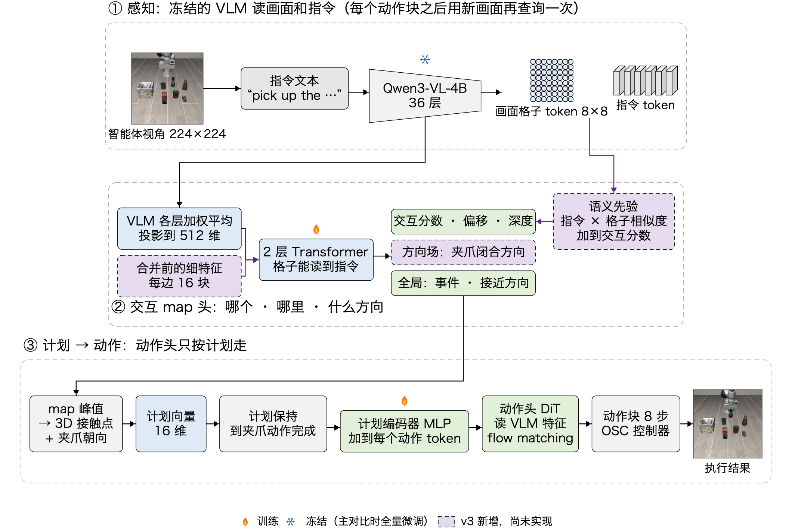
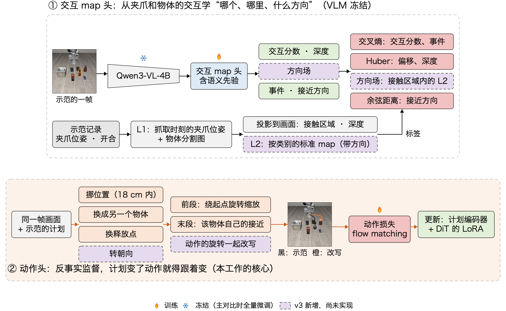
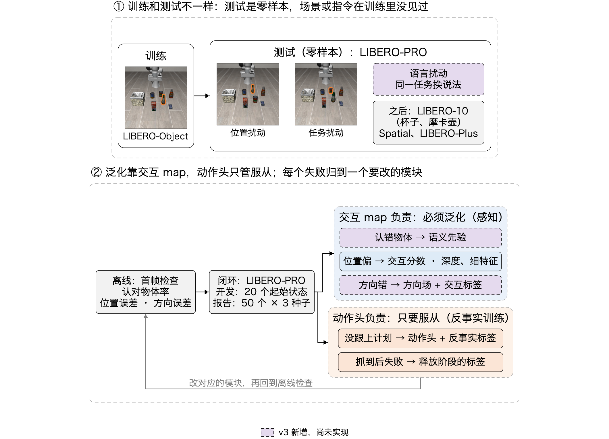

# VLA 方向文档

本仓库（`affordance-vla`）的研究方向：改变 VLA 的训练方式，让动作服从 affordance 计划。核心是一张带方向的交互 affordance map：它从夹爪和一类物体的交互中学来，说明认对哪个物体、在哪里接触、夹爪朝哪个方向；计划（接触点和夹爪位姿）从 map 解码，动作头用反事实样本训练成服从计划。目标是在杂乱的桌面操作仿真里，对训练时没见过的布局和指令也能做对（LIBERO-PRO 零样本）。必须训练 VLA，这是和记忆方向（环境记忆系统）的区别。现行设计见下面的 [Pipeline v3](2026-11-19_VLA_branch_Pipeline_v3.md)。

**仓库拆分（2026-11-10）：** 本仓库由 [affordance3D](https://github.com/zniihgnexy/affordance3D) 的 `vla` 分支带着完整提交历史独立出来；记忆方向（`mem`）留在 affordance3D。拆分之前写的文档里：

- "`vla` 分支"指的就是本仓库；
- "`mem` 分支"指 affordance3D 仓库里的记忆方向；
- "`main` 上的文档"指 `docs/vla/` 以外、从 affordance3D 带过来的早期文档，是两个方向共享的 brainstorming 基础，本仓库不再维护。

## 现行 pipeline：v3（2026-11-19 确认）

方法和实验以 [Pipeline v3](2026-11-19_VLA_branch_Pipeline_v3.md) 为准，要改方向先改那份文件。三张图分别讲测试时的模型、训练和泛化。紫色虚线框是 v3 新增、还没实现的部分，其余都已经在跑。图的规格和截图来源见[图的说明](../../report/media/pipeline_overview/README.md)。

**测试时的模型。** 冻结的 VLM 读画面和指令。交互 map 头给出每个点的交互分数、深度和方向场（夹爪闭合方向）；语义先验帮它认对指令说的物体。map 的峰值解码成 3D 接触点和夹爪朝向，压成 16 维计划，保持到夹爪动作完成。动作头读 VLM 特征，按计划生成 8 步动作。现在运行的是 map 头的第一版：8×8 格子，没有方向场。

**训练。** 两个头分开训练：
- 交互 map 头：标签来自夹爪和物体的交互。L1 是示范里抓取那一刻的夹爪位姿加物体分割图；L2 是按类别叠加的标准 map，再投影到每一帧。
- 动作头：用反事实样本训练。画面不变，把计划挪走，动作标签跟着改写。这是本工作的核心。

**泛化。** 只在标准 LIBERO 上训练，在 LIBERO-PRO 上零样本测试。泛化靠交互 map，动作头只负责服从。每个失败的回合都归到一个要改的模块。

## 当前状态（2026-11-19）

- **工作方式：** 以服务器上的 `~/affordance-vla` 为准，改动在服务器上提交并 push；大文件在 NAS 上，布局见 [V0 服务器搭建记录](2026-11-10_VLA_branch_V0_服务器搭建记录.md) 第 2 节。
- **阶段：** V0（核实与搭建）已完成，第一个诊断实验已做完。
  - 检索 R1–R3 和数据集汇报已完成；服务器上的训练环境、仿真环境、模型和数据都已就绪。
  - 已用 starVLA 官方开源权重在一个 LIBERO 任务上把整条流程跑通（见下面的流程 demo）。
  - **计划跟随实验（2026-11-11）：** 在冻结的官方权重上只训练一小部分参数，把真值计划交给动作头，看它跟不跟。结论见[实验记录](2026-11-11_VLA_branch_计划跟随实验.md)第 1 节。
  - **预测的计划驱动闭环（2026-11-13）：** 计划由冻结 VLM 上的一个小计划头从图像和指令预测，闭环里不再用任何真值计划。结论见[实验记录](2026-11-13_VLA_branch_预测计划驱动闭环.md)第 1 节。
    - 回归坐标的计划头记住的是布局，闭环里和官方权重一样（0/200、19/200）。
    - 对图像 8 × 8 个格子打分的计划头（VLM 分辨率下的 affordance map）能用。计划保持到夹爪事件完成，配上 13 日的动作头，LIBERO-PRO Object 位置扰动 113/200、任务扰动 130/200。
    - 换过的计划的动作标签改成"先对齐再下降"后，高的物体被碰倒的次数从 33、52 降到 8、19（真值计划）。
    - 把计划注入动作头每一层的对照（Fast Plans 的完整修法）没有让动作头服从计划。
  - 完整的方法（训练整个 VLA）还没有训练；以上都是冻结 VLM、约 3100 万参数的诊断规模，一个任务集，一个种子。
- **已决定（2026-11-10，项目负责人）：**
  1. GPU 作业优先放 0–3 号卡里的空卡；卡上有别的作业但显存够也可以放；只要能跑就排队跑，仍然都走队列。2026-11-11 更新：目前空的卡都可以用。
  2. 正式训练时两个项目分时间段使用服务器，一个时间段内 8 张卡都可用，具体安排到时由项目负责人逐个定。
  3. QwenPI-2B 全量微调单卡放不下的问题先搁置，等 VLA 模型部分讨论之后再定。
- **已同意（2026-11-11，项目负责人）：** 主线是"换过的计划加一致性损失"，先做计划跟随实验。实验做完后，这条主线已被下面 2026-11-12 的决定取代。
- **已决定（2026-11-12，项目负责人，针对项目评审提出的三点）：**
  1. **论点收束为"affordance 只有在动作被训练成服从它时才有用"。** 做法是反事实训练：同一帧图像，把 affordance 换到别处，动作标签按改过的路径重写。可微一致性损失降为一个对照；episode 状态移出主线，留作后续；统一的 CAW 计划只是接口的定义，不当贡献讲。[Pipeline v2](2026-11-10_VLA_branch_Pipeline_v2.md) 里的方法主张以此为准，benchmark、协议和算力部分仍然有效。
  2. **投稿：** 按 NeurIPS 2027 的要求来设计，2027 年 1 月底设检查点；如果到 2 月中只有 LIBERO 系列的结果，就投 IROS 2027 的窄版本。两边不投同一篇。
  3. **训练方式：** 主对比做一组全量微调，其余消融用轻量训练（约 3100 万参数那种）。这一条取代了之前"LoRA 不进主表"的规定，只对消融放宽。
- **已决定（2026-11-13，项目负责人，针对[实验记录](2026-11-13_VLA_branch_预测计划驱动闭环.md) 1.7 节的三件事）：**
  1. **之后的动作头默认用新的标签规则：** 先对齐再下降（`--align-first --rigid-tail 0.18`），加上搬运和释放阶段的反事实（`--counterfactual shift+other+release`），以及标签修正。
  2. **计划保持算方法的一部分：** 预测的计划保持到夹爪完成这次事件为止（`HOLD=1`）。
  3. **按论文协议重跑先等一等：** 等用新标签训练的十任务动作头的结果出来再定。2026-11-14 项目负责人同意后已执行，结果见下面的 notebook 和[实验记录](2026-11-13_VLA_branch_预测计划驱动闭环.md) 1.8 节。
- **已决定（2026-11-16，项目负责人，同意[诊断记录](2026-11-15_VLA_branch_任务扰动失败诊断.md)第 3 节的建议）：**
  1. **之后的动作头默认用 15 日的标签：** 以起点为中心旋转缩放路径前半段，最后一段取自指令所说物体自己的示范（`--counterfactual shift+other+release --supervision actions --rigid-tail 0.18 --scale-from-start --own-approach`）。代码里的默认值不变，以便复现以前的运行。
  2. **接着做：** 教动作头修正小的计划误差（"换成另一个物体"的样本加大计划噪声，`--other-noise`），然后提高计划头的精度。噪声的结果（11-16 晚，见[诊断记录](2026-11-15_VLA_branch_任务扰动失败诊断.md)第 3 节末尾）：tomato sauce 2 → 8 / 20，但合计没有提升（位置扰动 129 → 129，任务扰动 151 → 145 / 200，图像格子的计划）。建议不设为默认，等项目负责人定。
- **已决定（2026-11-16 晚，项目负责人，针对[周报](../../report/2026-11-16_weekly_review.ipynb)第 8 节）：**
  1. **下一个任务集先做 LIBERO-Spatial。** 场景里两只碗一样，"换成另一个物体"的样本按碗所在的位置称呼它（`affordance_vla/sim/spatial_language.py`）。LIBERO-PRO Spatial 任务扰动的 10 条指令里，5 条和这条规则生成的说法一字不差，另 5 条用了训练里没有的说法（"not between …"、"on the top of the cabinet"）；结果要分开报。
  2. **同一 backbone 的基线：** 先列 5 个候选，再定 3 个。候选：普通微调（A）、计划输入只用示范（B）、affordance 只作辅助预测（C）、有反事实数据但没有计划接口（D）、Fast Plans 修法（E）；我推荐 B、D、E，官方权重作参考行，等项目负责人确认。
  3. **全量训练的整机时段：** 暂定；需要时提前通知项目负责人协调。
  4. 实验进度先到这里，项目负责人在做深度调研。
- **已决定（2026-11-19，项目负责人，同意 [Pipeline v3](2026-11-19_VLA_branch_Pipeline_v3.md) 第 10 节的 6 条）：**
  1. **v3 取代 [Pipeline v2](2026-11-10_VLA_branch_Pipeline_v2.md) 的方法部分，作为之后的指导。**
     - 计划从"抓哪里"扩成三件事：认对哪个（语义先验，借鉴 SemanticVLA）、抓哪里、夹爪怎么摆（朝向）。
     - 泛化靠计划头，动作头只负责服从。
  2. **实验按 v3 第 5 节的顺序和通过标准做：** E0 位姿假设检验 → E1 语义诊断 → E2 语义先验 → E3 更细的几何（视需要）→ E4 位姿上界 → E5 预测朝向 → E6 基线 → E7 推广。
  3. **同骨干基线定为 B、D、E、F 四个**，其中 F 是隐式语义、没有 affordance；官方权重作参考行。这一条取代 11-16 定下的"选 3 个"。
  4. **测试加上 LIBERO-PRO 的语言扰动套件**（`libero_object_lan`）。
  5. **LIBERO-Spatial 挪到 E7**：先在 Object 上把 v3 的模块验证完。这改变了 11-16 晚决定第 1 条的顺序。
  6. **恢复实验，从 E0、E1 开始。** 开始之前，项目负责人还有问题要问。
- **已决定（2026-11-19 晚，项目负责人，确认 [Pipeline v3](2026-11-19_VLA_branch_Pipeline_v3.md) 的修订）：**
  1. **定位改为以带方向的交互 affordance map 为核心。**
     - map 从夹爪和一类物体的交互中学来，给出交互分数、深度和方向场（夹爪闭合方向）。
     - 计划（接触点和夹爪位姿）从 map 解码，不再单独回归 6D 朝向。
  2. **标签用 L1 + L2：**
     - L1：示范里抓取那一刻的夹爪位姿，加上物体分割图；
     - L2：同一类物体的抓取叠加成标准 map，再按物体位姿投影到每一帧。为此要重新回放示范，补记物体位姿。
     - 物体位姿只用来生成标签和做评测，测试时不输入模型。
     - L3（脚本抓取）暂不做。
  3. **第一版做 2D 图像上的 map（加深度），** 不做 3D 点云。
  4. **朝向的主要测试加上有把手物体的任务集：** LIBERO-10 和它的 LIBERO-PRO 版本。
  5. **用 map 的相似度读物体朝向放在第二阶段，** 第一版只读夹爪朝向。
  6. **两条细节：**
     - 语义图的合并方式在 E1 里不训练、直接比较求和与取最大值，选定其一；
     - "转朝向"先设绕竖直轴 ±45°，等 E0 结果再定。
  7. **新的实验顺序：** E0、E1、L 同时做，然后 E2 语义先验 → E3 朝向上界 → E4 交互 map 头 → E5 用 map 解码的计划做闭环 → E6 基线 → E7 推广。
- **仓库整理与本机仿真（2026-11-17，项目负责人要求）：** 研究代码按 [AGENTS.md](../../AGENTS.md) 的要求维护（每个文件不超过 500 行、共享模块、配置驱动、每个实验一条命令）。代码包改名为 `affordance_vla`，按领域分子目录；脚本按用途分到 `scripts/`，环境放进 `envs/`；全部实验的命令和设置在 [EXPERIMENTS.md](../../EXPERIMENTS.md)。Mac 上可以在 MuJoCo 窗口里打开 LIBERO-PRO 场景、执行脚本抓取、逐步回放服务器上的测试，见[本机仿真](../local_simulation.md)。训练和评测的设置还没有挪进 `configs/`（AGENTS.md Part B）。
- **近邻核实后的定位（2026-11-12，[R9](2026-11-12_VLA_branch_R9_服从性与反事实训练的近邻核实.md)）：**
  - "计划被动作头绕过"这个现象已经有人立住（Fast Plans, Faithful Actions），不能当贡献。
  - 做法上最近的是 SIDO：图像不变、改显式的位置输入、解析地改写动作，但它不是 VLA，没有语言，也没有换目标。我们这一整套没有查到完全相同的。
  - 贡献要落在两件事上：反事实 affordance 监督与已有修法的正面比较；预测的 affordance 驱动下，在 LIBERO-PRO 位置和任务扰动上的结果。
  - 新颖性比评审时判断的薄，NeurIPS 的把握下降，IROS 的窄版本更现实。
- **下一步：** 2026-11-19 起以 [Pipeline v3](2026-11-19_VLA_branch_Pipeline_v3.md) 第 5 节的 E0–E7 为准，下面是 11-13 到 11-16 的记录。前一版的 1–3 项已做完：噪声和丢弃的对照（11-12）、深层注入的对照（11-13）、预测的计划驱动闭环（11-13）、LIBERO-PRO Object 的基线（11-12）。搬运和释放的反事实做了：单独没用，和"先对齐"一起有用。
  1. **按论文协议的结果（2026-11-14，已完成）：** 不用真值计划 0.660 ± 0.012（位置扰动）、0.681 ± 0.012（任务扰动）；真值计划 0.920、0.753；官方权重 0.000、0.090。下一步是查清任务扰动下番茄酱瓶、牛奶、橙汁三个任务里动作头为什么失败（给真值计划也失败）。
  2. **任务扰动失败的诊断（2026-11-15，已完成，[诊断记录](2026-11-15_VLA_branch_任务扰动失败诊断.md)）：** 原因在"换成另一个物体"的训练标签：要的物体离夹爪起点很近时，挪过去的示范路径会绕远路（先远离 14–18 厘米），而且最后一段抄的是场景原目标的接近方式。建议的修法（前半段以起点为中心旋转缩放；最后一段取自要的物体自己的示范）2026-11-15 经项目负责人同意后已检验（2026-11-16）：任务扰动真值计划 152 → 166/200、图像格子计划保持 136 → 151/200，橙汁 8 → 18；位置扰动用图像格子计划时 tomato sauce 13 → 2（新动作头更严格地跟着偏了 3 厘米的计划）。是否设为默认、下一步做哪几条，见[诊断记录](2026-11-15_VLA_branch_任务扰动失败诊断.md)第 3 节。
  2. 计划头也在闭环 rollout 的帧上训练，使每次查询都预测的计划和保持的计划一样好。
  3. 高的物体：预测抓取点在它们上的误差，以及更细的 map（更多格子或用腕部相机）能否补上差距。
  4. 十任务的动作头用新标签；其余三个任务集；按论文协议（50 个起始状态、多个种子）重跑后再和论文数字并列；第二个架构；放大规模。
  - 每个扰动条件至少用 6 个起始状态。
  - 需要项目负责人决定的三件事见[实验记录](2026-11-13_VLA_branch_预测计划驱动闭环.md) 1.7 节。

## 入口

1. [Pipeline v3（2026-11-19）](2026-11-19_VLA_branch_Pipeline_v3.md)：现行的方法和实验指导，包括三张图、模块、训练、测试、实验顺序和通过标准、基线、不做的事、停止规则。
2. [Pipeline v2（2026-11-10）](2026-11-10_VLA_branch_Pipeline_v2.md)：方法部分已被 v3 取代；backbone 和 benchmark 选型、实验配置、算力部分仍然有效。
3. [检索结果：backbone、benchmark 与近邻（2026-11-10）](2026-11-10_VLA_branch_检索结果_backbone_benchmark_近邻.md)：三个检索 agent 的原始报告。
4. [R1 近邻全文核实（2026-11-10）](2026-11-10_VLA_branch_R1_近邻全文核实.md)：六篇最接近的工作逐篇核对，以及 ObjDream、Ledger 等新发现的近邻。
5. [R2 LIBERO 变体协议（2026-11-10）](2026-11-10_VLA_branch_R2_LIBERO变体协议.md)：三个 LIBERO 变体的训练与评测协议、公开数据的内容，以及哪些标签可以直接读取、哪些需要回放。
6. [R3 A6000 训练成本（2026-11-10）](2026-11-10_VLA_branch_R3_A6000训练成本.md)：starVLA 和 π0.5 在 8 卡 A6000 上的显存、时间和总 GPU 小时估计。
7. [V0 服务器搭建记录（2026-11-10）](2026-11-10_VLA_branch_V0_服务器搭建记录.md)：A6000 服务器上的目录、环境、数据和脚本，GPU 队列的用法，以及提交探测前要决定的事。
8. [检索清单与 Pipeline v1（2026-11-10）](2026-11-10_VLA_branch_检索清单与Pipeline_v1.md)：已被取代，保留作历史记录。
9. [计划跟随实验（2026-11-11）](2026-11-11_VLA_branch_计划跟随实验.md)：第一个训练实验的结论、设置、做法和复现步骤。
10. [R9 服从性与反事实训练的近邻核实（2026-11-12）](2026-11-12_VLA_branch_R9_服从性与反事实训练的近邻核实.md)：新论点的近邻、已有修法的分类、LIBERO-PRO 上各方法的数字，以及对论点的影响。
11. [预测的计划驱动闭环（2026-11-13）](2026-11-13_VLA_branch_预测计划驱动闭环.md)：两个计划头、计划保持、深层注入的对照、三处标签改动和 13 日的动作头，以及需要决定的事。
12. [任务扰动失败的诊断（2026-11-15）](2026-11-15_VLA_branch_任务扰动失败诊断.md)：三个任务给真值计划也失败的原因、证据和建议的修法。

后续检索结果、选型和实验记录都放在本目录，文件名以日期开头。

## 汇报 notebook

- [周报：2026-11-09 至 11-15（2026-11-16）](../../report/2026-11-16_weekly_review.ipynb)：开头的"先看这里"一节用一页讲清在做什么、为什么、每一步为什么这样选、接下来的预期，附整体流程图（11-16 晚补）；之后是一周的时间线、每个主要结果的细节（表格和图从已跑完的结果现算），负结果，以及离目标研究范围还差什么、时间规划和需要决定的事。
- [新标签的检验（2026-11-16）](../../report/2026-11-16_label_fix_results.ipynb)：只有标签不同的两个十任务动作头，在 LIBERO-PRO Object 两种扰动上各配真值计划和图像格子计划保持，每个任务 20 个起始状态。
  - **主要结果：** 任务扰动真值计划 152 → 166、图像格子 136 → 151；橙汁 8 → 18、7 → 16；牛奶只在真值计划下上升；番茄酱瓶的问题挪到抓取和搬运；位置扰动下 tomato sauce 用图像格子计划从 13 掉到 2。
  - **哪些是 ORACLE：** 标着"oracle plan"的列的计划；用来比较的抓取点。
- [任务扰动下三个任务为什么失败（2026-11-15）](../../report/2026-11-15_task_perturbation_failures.ipynb)：只用已有日志和示范的诊断，没有跑新作业。
  - **内容：** 每个任务设在谁的场景里、夹爪多久到达、多少次跑到步数上限、悬停多久；一条失败的橙汁 rollout 和位置扰动下同一位置的成功 rollout 逐步对比；这些场景里"换成另一个物体"的训练标签走的路径；每种物体示范的最后一段接近方式。
  - **哪些是真的：** 按论文协议跑的闭环日志；示范数据；训练标签用和训练时同一段代码算出。
  - **哪些是 ORACLE：** 这些闭环里给的计划。
  - **主要结论：** 失败大多是悬停后时间用完（橙汁、番茄酱瓶）和碰倒（牛奶）；原因是这些场景里的标签绕远路、并抄了原目标的接近方式。
- [LIBERO-PRO Object 按论文协议（2026-11-14）](../../report/2026-11-14_libero_pro_full_protocol.ipynb)：每个任务 50 个起始状态、三个评测种子。
  - **内容：** 每个种子的成功数、均值和种子间的标准差；和论文数字并列；逐任务（三个种子合起来）；指令里的物体最后怎样了；计划的配置走到了哪一步。
  - **哪些是真的：** benchmark 的场景、起始状态和成功判定；官方权重；十任务新标签动作头；图像格子计划头和它保持的计划；全部 9000 条闭环。
  - **哪些是 ORACLE：** 第三个配置的计划（上限）；计划头用的相机标定来自仿真。
  - **主要结果：** 不用真值计划 0.660 ± 0.012、0.681 ± 0.012；真值计划 0.920、0.753；官方权重 0.000、0.090。论文：GAM 0.47、0.50，CounterAlign 0.51、0.26，π0.5 加测试时 affordance 场 0.73（只有位置扰动）。
  - **还不能说的：** 底座模型和测试时用的信息都和论文不同，不是同条件下的方法比较；种子只改变评测，没有重新训练。
  - **重新运行：** 按 notebook 开头的说明提交 9 个队列作业，然后在 `report/` 下运行 `scripts/report/build_libero_pro_full_report.py` 并执行 notebook。
- [预测的计划驱动闭环（2026-11-13）](../../report/2026-11-13_plan_predictor.ipynb)：第一次在 LIBERO-PRO 上完全不用真值计划。
  - **内容：** 两个计划头（回归坐标、对图像格子打分）；它们在没训练过的帧上的误差；预测的接触点和格子分数画在图上；闭环成功数；每条 rollout 的计划指向了哪个物体；第二个动作头（先对齐再下降、搬运和释放的反事实）在六任务集和 LIBERO-PRO 上的结果。
  - **哪些是真的：** 两个计划头和它们的全部输出；动作头；全部闭环；benchmark 的场景、起始状态和成功判定。
  - **哪些是 ORACLE：** 计划头的训练目标（示范里下一次夹爪事件的接触点）、图上的圆圈、标着"ORACLE plan"的列；图像格子的计划头用仿真里的相机标定把像素和深度换成三维点。
  - **主要结果（10 个任务 × 20 次）：** 回归坐标 0/200、19/200（和官方权重一样）；图像格子每次查询都预测 72、90；计划保持 102、113；换成 13 日的动作头 113、130；13 日的标签、十个任务都训练的动作头 133、136（目前最好，0.67、0.68）。真值计划：11 日的动作头 164、136，十任务新标签的动作头 185、152，13 日的 175、141。高的物体被碰倒的次数（真值计划）从 33、52 降到 8、19。
  - **拆开三处标签改动：** 被碰倒次数的下降来自"先对齐"；释放阶段的反事实和它一起才有用；标签修正单独不起作用。
  - **还不能说的：** 成功数之间的差别多在两个标准误以内；协议比论文宽松（每个任务 20 个起始状态、一个种子）。
  - **重新运行：** 按[实验记录](2026-11-13_VLA_branch_预测计划驱动闭环.md)第 4 节提交队列作业，然后在 `report/` 下运行 `scripts/report/build_plan_predictor_report.py` 并执行 notebook。
- [LIBERO-PRO Object 任务集：官方权重与"真值计划"上限（2026-11-12）](../../report/2026-11-12_libero_pro_object.ipynb)：第一次在官方的扰动 benchmark 上出数字。
  - **内容：** 两种扰动长什么样；官方权重（不给计划）和反事实训练的动作头（给真值计划）各 400 条闭环；逐任务的成功数；失败发生在哪一步；其他论文在同一 benchmark 上报告的数字。
  - **哪些是真的：** benchmark 的场景、起始状态和成功判定；两个策略的全部闭环。
  - **哪些是 ORACLE：** 第二个策略拿到的计划（仿真里的物体位置加示范的平均抓取偏移）。这一列是计划头的上限，不是方法的结果。
  - **主要结果（10 个任务 × 20 次）：** 位置扰动，官方权重 0/200，给真值计划 164/200；任务扰动，20/200 对 136/200。动作头训练时没见过的 bbq sauce、butter、chocolate pudding 在位置扰动下都是 20/20。失败主要是高的物体被碰倒、夹住后没送进篮子。
  - **和已发表数字的关系：** Object 任务集上，位置扰动已发表的最高是 0.73（测试时用深度和 GPT-4o），只靠训练的是 0.51；任务扰动是 0.50。真值计划给出 0.82 和 0.68。协议不完全一致，只能粗略对照。
  - **重新运行：** `envs/server/setup_libero_pro.sh`（CPU），再按 `scripts/eval/run_libero_pro_gpu.sh` 文件头提交两个队列作业，然后在 `report/` 下运行 `scripts/report/build_libero_pro_report.py` 并执行 notebook。
  - **对应代码：** `affordance_vla/sim/benchmark_text.py`（扰动任务的指令）、`report/libero_pro_helpers.py`（表和图）。
- [加入 affordance map 后的流程逐步演示（2026-11-11）](../../report/2026-11-11_affordance_pipeline_walkthrough.ipynb)：取一条真实的闭环，在其中一个时刻把流程的 9 步逐个画出输入和输出，再给出整条 episode 的画面、曲线和视频。用来讨论，不是实验结果。
  - **内容：** 观察（两路图像、深度、相机）；VLM（每张图 8×8 个 token）；affordance map；从 map 取 3D 点；接近方向；计划的 10 个数；动作块；控制器执行；episode 状态。
  - **哪些是真的：** 图像、深度和相机、VLM 和动作头、每次查询送入的计划、动作块、机器人的运动。
  - **哪些是 ORACLE：** affordance map、计划的接触点、接近方向、抓还是放、episode 状态，都由仿真真值算出。闭环是由真值接触点驱动的，map 只是画在旁边，没有参与控制。
  - **看到的事：** map 给出的是物体表面上的点，计划要的是夹爪中心；抓取时两者水平相差 0.9–2.1 厘米，释放时计划点在 map 的点上方约 8.4–9.3 厘米。VLM 的一个图像 token 覆盖 32×32 像素，比 tomato sauce 罐子（18×25 像素）还大。
  - **引出的问题：** map 标什么、3D 接触点从哪来、谁决定抓和放的切换、8×8 个 token 够不够。见 notebook 最后一节。
  - **重新运行：** 按 `scripts/report/build_affordance_pipeline_walkthrough.py` 文件头的说明，先通过队列跑一次带深度的评测（`run_plan_following_gpu.sh`，`DEPTH=1 SUFFIX=_depth`），再构建并执行 notebook。
  - **对应代码：** `affordance_vla/plan/affordance_map.py`（由真值生成的 map，以及 map 对应的 3D 点）、`affordance_vla/sim/libero_camera.py` 的 `unproject_depth`（深度图反投影）、`report/affordance_pipeline_helpers.py`（图和表）。
- [计划跟随实验（2026-11-11）](../../report/2026-11-11_plan_following_experiment.ipynb)：把真值计划交给官方权重的动作头，看它是否跟随。
  - **内容：** 示范的状态回放；计划输入；换过的计划和目标路径；训练曲线；开环指标；闭环结果（三个模型，各 5 条标准、18 条目标挪动、30 条换物体）；分阶段统计；指令的抖动；结论和要决定的事。
  - **哪些是真的：** 示范、开源模型、训练、开环数字、闭环 rollout。
  - **哪些是 ORACLE：** 计划本身。训练时来自示范，闭环时来自仿真真值。
  - **主要结果：** 只把计划当输入会被忽略；训练时加入换过的计划之后，夹爪 18 次里 18 次到达挪动后的抓取点，换物体时 30 次里 27–30 次到达、成功次数从 6 次升到 19–20 次；改写动作标签和一致性损失效果相当。
  - **重新运行：** 见[实验记录](2026-11-11_VLA_branch_计划跟随实验.md)第 4 节。
- [流程 demo（2026-11-10）](../../report/2026-11-10_vla_pipeline_demo.ipynb)：用 LIBERO-Object 的一个任务和 starVLA 官方权重 `Qwen3-VL-PI-LIBERO-4in1`，一步一步走完整条流程。
  - **内容：** 训练样本；模型内部（token、隐状态、4 步去噪）；开环预测和训练损失；闭环 rollout（标准、换指令、挪动目标，共 21 条）；CAW 标签；计划–动作一致性度量；episode 状态。
  - **哪些是真的：** 数据、开源模型、它的开环和闭环动作、仿真日志，以及由日志算出的所有数字。
  - **哪些还是占位（notebook 里标为 ORACLE）：** CAW 计划、一致性度量里的"计划"、episode 状态。它们都由示范回放和仿真真值算出，还没有模型预测它们。
  - **主要结果：** 按训练时的指令 5 次全部成功；指令换成场景里别的物体，10 次里 8 次拿错；目标挪动 4–16 厘米，6 次里只成功 1 次。整组 21 条跑了两遍，20 条的结果相同。
  - **重新运行（都在服务器上）：**
    1. `envs/server/setup_libero_env.sh`，建 LIBERO 仿真环境；
    2. `scripts/data/fetch_modelscope_model.sh`，下载官方权重和 Qwen3-VL-4B；
    3. 按 `scripts/vla/run_vla_demo_gpu.sh` 文件头的说明，先在 CPU 上回放一条示范，再把这个脚本提交到 GPU 队列；
    4. 在 `report/` 下运行 `scripts/report/build_vla_pipeline_demo.py`，再执行 notebook。
  - **对应代码：** `affordance_vla/` 下的 `plan_consistency.py`（一致性度量）、`episode_state.py`（episode 状态）、`rollout_outcome.py`（结果分类）、`rollout_log.py`（读日志）、`libero_camera.py`（相机投影）；`report/` 下的 `vla_pipeline_demo_helpers.py` 和 `vla_pipeline_demo_labels.py`（图和表）。
- [数据集与仿真环境汇报（2026-11-10）](../../report/2026-11-10_vla_datasets_sim_report.ipynb)：各 benchmark 的能力对照表和官方 teaser 图，LIBERO-Plus 及两个诊断集的说明，一个 LIBERO-Object 任务的细节（视频、末端路径、CAW 标签、动作积分检查），以及 RoboTwin 2.0 Hard。
- 重新运行前先准备：
  1. `python -m pip install h5py==3.16.0`，在 `affordance3d` 环境里装（已写入 `envs/legacy/requirements_mac_e0.txt`）；
  2. `bash scripts/report/download_vla_report_images.sh`，下载官方图片；
  3. `bash scripts/data/download_libero_demo.sh`，下载约 664MB 的任务文件和它的 BDDL，存到本仓库的 `data/libero/` 下（不进 git）。
- 对应代码：`affordance_vla/sim/libero_io.py`（读取 LIBERO 文件）、`affordance_vla/plan/caw_labels.py`（从末端路径和夹爪指令生成 CAW 标签，检查动作积分）、`report/vla_report_helpers.py`（表格和图）。
